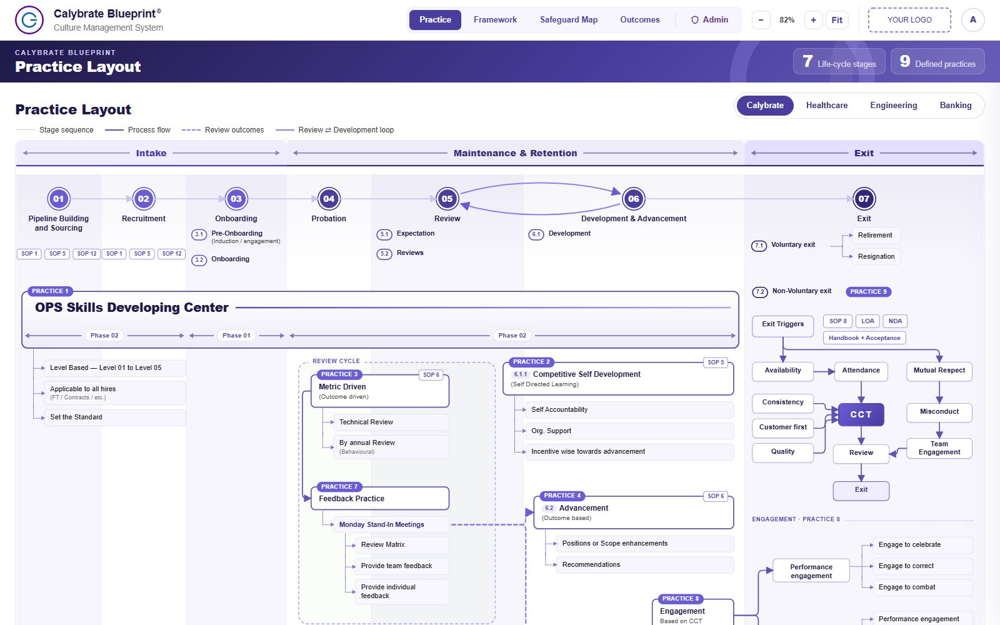
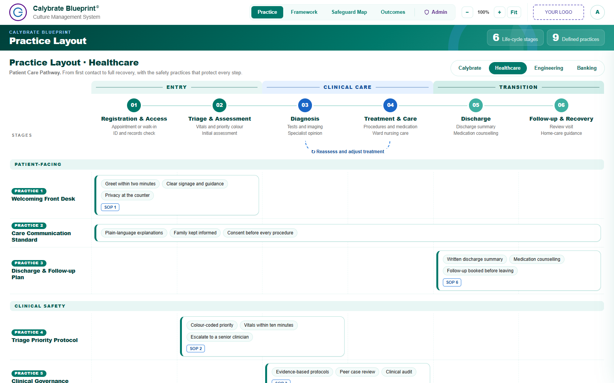
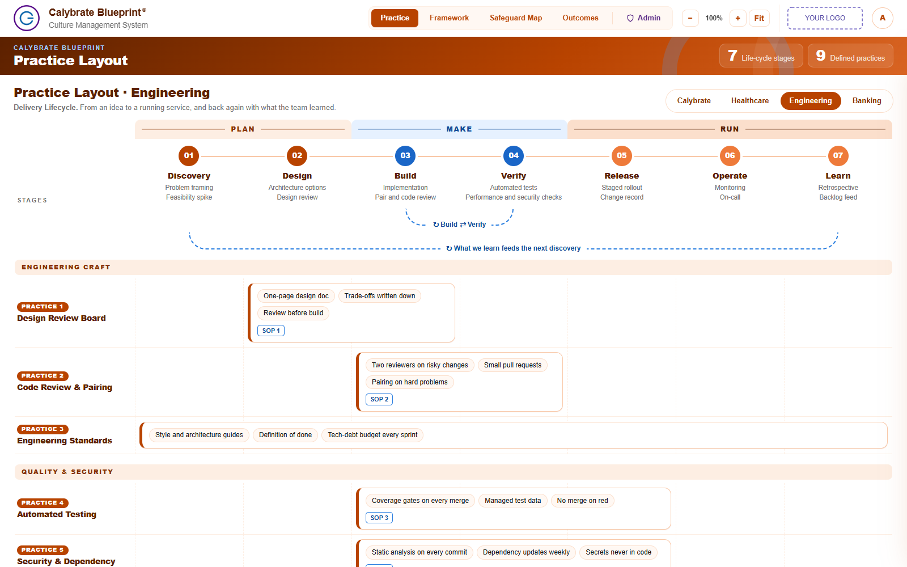
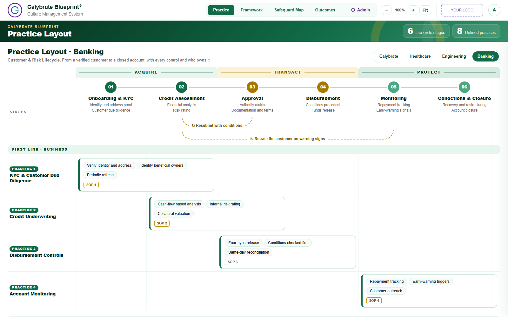
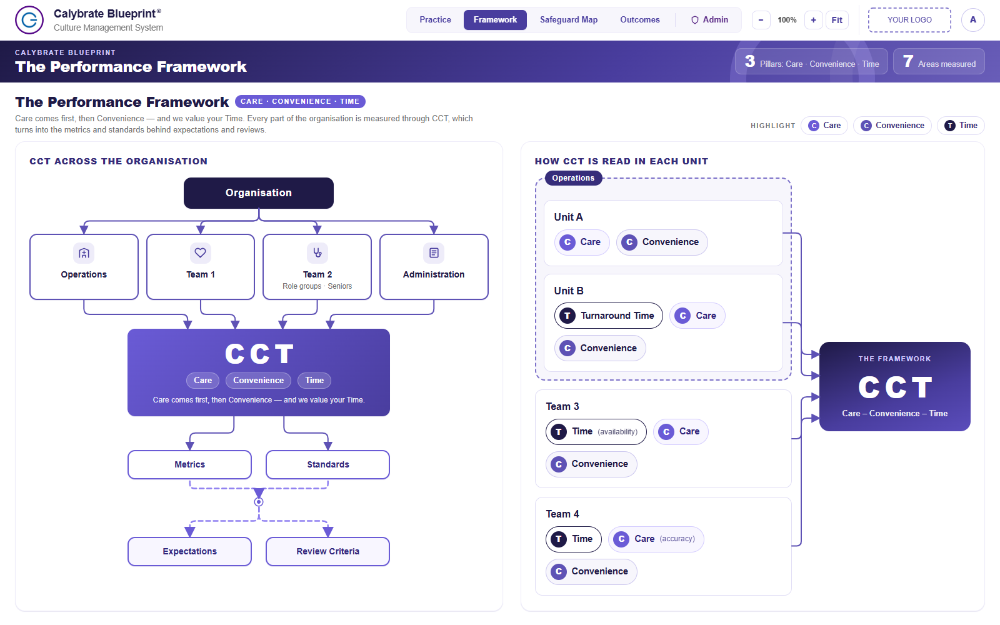
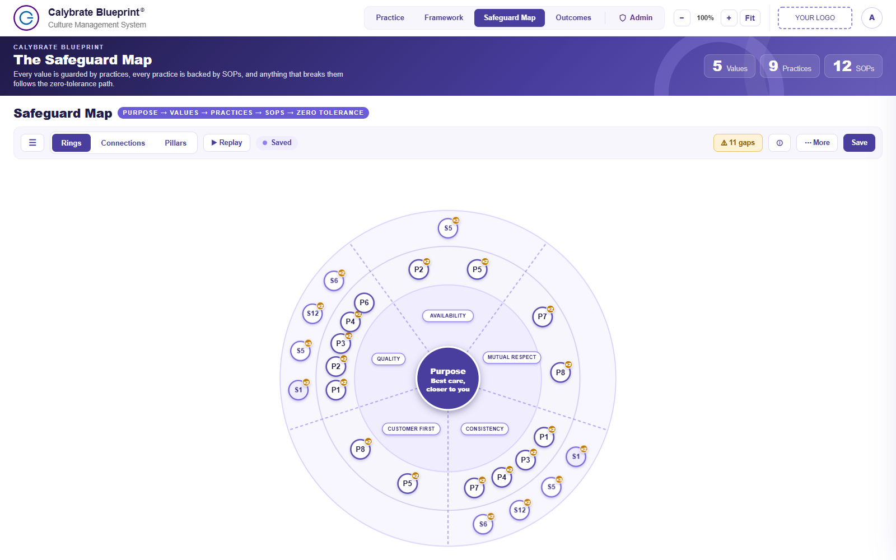
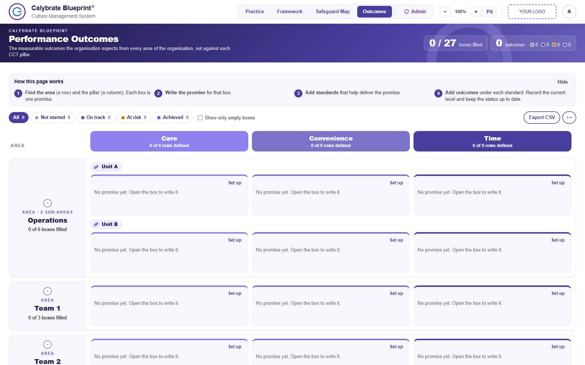
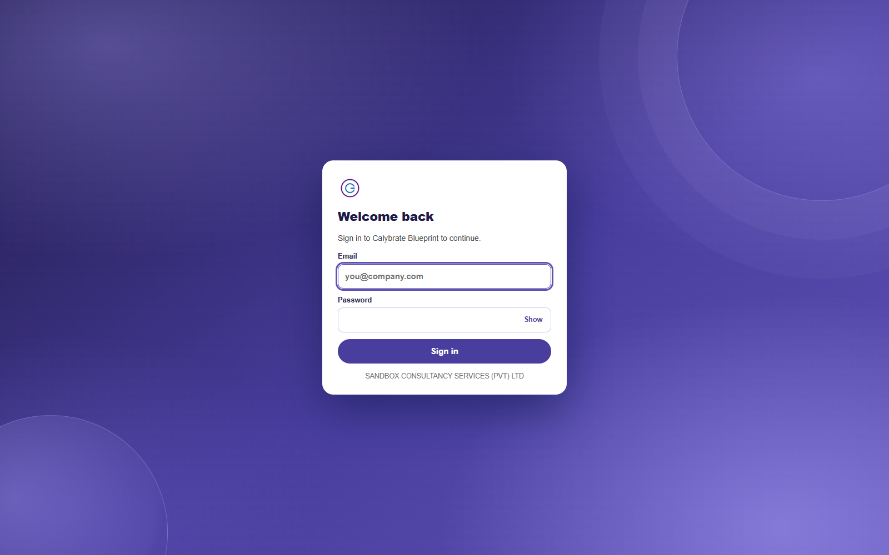

# Calybrate Blueprint

**A culture-management web app: see how your organisation's purpose and values are protected by practices and SOPs, how people move through the life cycle, and which measurable outcomes each team owes.**

Built with React, TypeScript and Vite, with Supabase for the database and sign-in. It ships with four ready-made themes and Practice Layouts for **Healthcare**, **Engineering** and **Banking**, so one codebase can serve several industries.



## What's inside

| View (`#link`) | What it is |
|---|---|
| **Practice Layout** (`#lifecycle`) | The life cycle and the practices that run through it, with SOP chips and a details drawer. Four tabs: Calybrate, Healthcare, Engineering, Banking, each with its own layout |
| **Framework** (`#cct`) | How CCT (Care · Convenience · Time) runs through the organisation and each unit; chips open the matching outcomes |
| **Safeguard Map** (`#map`) | Purpose → Values → Practices → SOPs → Zero tolerance. Rings, Connections and Pillars views; drag SOPs onto practices and practices onto values |
| **Outcomes** (`#outcomes`) | Measurable outcomes for every area against each pillar: quick add, status, targets, CSV export |
| **Admin** (`#admin`, admins only) | Users and roles, activity log, backup and restore, areas and pillars |

Roles: **Viewer** reads, **Editor** edits, **Admin** manages everything.

## Screenshots

### Practice Layout, one per category

Each category is its own layout, not a relabelled copy: different stages, practices, groupings, feedback loops and paths. Clicking a tab also switches the colour theme to match.

| | |
|---|---|
| <br>**Healthcare**: Patient Care Pathway, 6 stages, 9 practices | <br>**Engineering**: Delivery Lifecycle, 7 stages, 9 practices |
| <br>**Banking**: Customer & Risk Lifecycle, 6 stages, practices by line of defence | <br>**Calybrate**: the original seven-stage life cycle |

### The rest of the app

| | |
|---|---|
| <br>**Framework**: CCT across the organisation | <br>**Safeguard Map**: purpose, values, practices and SOPs |
| <br>**Outcomes**: targets and status per area and pillar | <br>**Login** |

## Quick start

Needs Node 20+.

```bash
cd app
npm install
npm run dev                    # http://localhost:5173
```

With no database settings the app runs in an **offline mode**: everything is editable and stored in your browser. A front-end **test login** sits in front of it so you can try the sign-in flow:

| | |
|---|---|
| Email | `angelo@sandbox.lk` |
| Password | `Sandbox@123` |

> **The test login is for demos and testing only.** The check happens in the browser and the details are in the page source, so it is not security. It switches itself off as soon as Supabase is configured, and you can turn it off with `VITE_TEST_LOGIN=0`. A **production build never runs offline**: without Supabase settings it shows a "Not set up yet" screen and nothing else.

To use the real sign-in (username, password and authenticator code), copy `app/.env.example` to `app/.env.local` and fill in the Supabase URL and the anon key (never the service-role key).

## Checks

Run before every merge:

```bash
npm run typecheck && npm run lint && npm test && npm run build
npm run test:e2e               # browser tests; needs no database
```

## Make it yours

| To change | Where |
|---|---|
| Colours and fonts | `app/src/styles/base.css` (default theme) and `app/src/styles/themes.css` (Healthcare, Engineering, Banking) |
| Logos | `app/public/` (`Calybrate_LOGO.png` for the brand, `logo.svg` for the client logo slot) |
| Add an industry to Practice Layout | Copy `app/src/features/lifecycle/categories/engineering.ts`, add it to `categories/index.ts`, add a theme block in `themes.css` and its id in `app/src/app/theme.ts` |
| Values, practices and SOPs | `supabase/seed.sql` and `app/src/features/map/data.ts` |
| Test login details | `app/src/features/auth/testLogin.ts` |

To regenerate the screenshots in this README, start `npm run dev` in one terminal and run `npm run screenshots` in another (uses your installed Chrome).

## Repository layout

```
app/          The web app: Vite + React + TypeScript (this is what gets deployed)
supabase/     Database migrations, seed data, the admin-users Edge Function
scripts/      One-off SQL (bootstrap-admin.sql creates the first admin)
docs/         Architecture, database, security, deployment, decision records (docs/adr), README images
```

## Set up a new environment

1. Create a Supabase project and run the SQL in `supabase/migrations/` in order (`0003`–`0008`, `0010`, `0011` onward; `0001`/`0002`/`0009` belong to the first prototype), then `supabase/seed.sql`. Add `codex` and `outcomes` to **Project Settings > API > Exposed schemas**.
2. Deploy the `admin-users` Edge Function and create the first admin with `scripts/bootstrap-admin.sql` ([docs/security.md](docs/security.md)).
3. Deploy the app to Vercel ([docs/deployment.md](docs/deployment.md)).

## Deployment

Vercel project settings (Settings > Build & Development / Git / Environment Variables):

| Setting | Value |
|---|---|
| Production Branch | the branch you deploy from (for example `main`) |
| Framework Preset | Vite |
| **Root Directory** | **`app`** |
| Build Command | `npm run build` (the default) |
| Output Directory | `dist` (the default) |
| Environment variables | `VITE_SUPABASE_URL`, `VITE_SUPABASE_ANON_KEY` (anon key only), `VITE_ADMIN_FUNCTION` (the deployed function name; default `admin-users`); optional `VITE_USER_DOMAIN`, `VITE_IDLE_MINUTES` |

If the site shows **"Not set up yet"**, the Supabase variables are missing for that environment: add them (Production, and Preview if used) and redeploy. Full steps: [docs/deployment.md](docs/deployment.md).

## More

- [docs/ARCHITECTURE.md](docs/ARCHITECTURE.md): structure and conventions
- [docs/database.md](docs/database.md): tables, functions and row-level security
- [docs/security.md](docs/security.md): sign-in, roles and hardening
- [docs/adr/](docs/adr/): why things are the way they are
