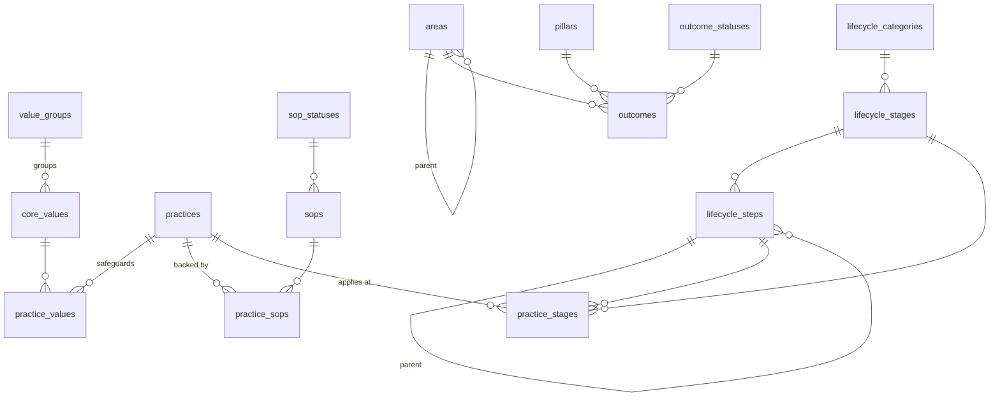

# Database design

Postgres on Supabase. The schema is built by the numbered files in `supabase/migrations/` and seeded by `supabase/seed.sql`. The column dictionary below is generated from the live database comments (`COMMENT ON`), so the database is the source of truth.

## Schemas

| Schema | Purpose | API |
|---|---|---|
| `codex` | Business Codex: values, practices, SOPs, life-cycle stages, saved layouts | exposed |
| `outcomes` | CCT Framework outcomes: areas x pillars | exposed |
| `audit` | Append-only change history | **not exposed** |

## Conventions

- snake_case; plural table names; singular `id uuid` surrogate primary keys (`gen_random_uuid()`).
- A stable, human-readable `code` (lower-kebab-case, or `P1`..`P9` for practices) with a UNIQUE constraint identifies business rows. Display codes are never primary keys.
- Foreign keys are named `<entity>_id`. Constraints are named `pk_`, `fk_`, `uq_`, `ck_` + table + column/rule. Indexes are `ix_` + table + column.
- Enumerations are lookup tables (`pillars`, `outcome_statuses`, `sop_statuses`, `lifecycle_categories`, `value_groups`), not CHECK lists, so they can grow without a migration.
- Entity tables carry `created_at`, `updated_at`, `created_by`, `updated_by` (set by trigger; `*_by` is NULL until login exists). Link tables carry `created_at`, `created_by`.
- `sort_order` controls display order; `is_active` hides a row without deleting it.
- Every table and column has a `COMMENT ON`. Migrations are immutable history; changes go in a new numbered file.
- Writes that touch several rows go through functions (`codex.apply_layout`, `outcomes.save_box`) so they are atomic and change only what differs.

## Entity relationship diagram

`codex` holds the first nine tables above plus `layout_snapshots`; `outcomes` holds `areas`, `pillars`, `outcome_statuses`, `outcomes`.

## Security (current phase)

- Row Level Security is enabled on every table. There is **no login yet**: the public (anon) key can read everything and write only business data.
- Reference tables (value groups, values, practices, statuses, stages, areas, pillars) are read-only for API roles.
- Writable: `codex.practice_sops`, `codex.practice_values`, `codex.layout_snapshots`, `outcomes.outcomes`, and `codex.sops.status_id` (column-level grant).
- Those write policies are named `temp_open_write_*`. When Supabase Auth is added, replace them with role-based policies; `created_by` / `updated_by` / `audit.change_log.changed_by` will then be filled automatically.
- `audit.change_log` has RLS with no policies and no grants: only the database owner can read it.

## Functions

| Function | Purpose |
|---|---|
| `codex.apply_layout(p_layout jsonb, p_done_sops integer[])` | Applies a practice/SOP/value layout and optionally the finished SOPs, changing only what differs. |
| `outcomes.enforce_leaf_area()` |  |
| `outcomes.save_box(p_area_code text, p_pillar_code text, p_promise text, p_standards jsonb)` | Saves the promise, standards and outcomes of one area x active pillar box in a single transaction (see ADR 0006). |

## Data dictionary

### `app.profiles`

One row per person who can sign in. Created and changed only by admins.

| Column | Type | Null | Default | Description |
|---|---|---|---|---|
| `user_id` | uuid | no |  |  |
| `username` | text | no |  | Sign-in name (lower case). The login form maps it to an internal address that is never emailed. |
| `display_name` | text | no |  |  |
| `role_id` | uuid | no |  |  |
| `is_active` | boolean | no | `true` |  |
| `must_change_password` | boolean | no | `true` | True until the person replaces the temporary password they were given. |
| `created_at` | timestamp with time zone | no | `now()` |  |
| `updated_at` | timestamp with time zone | no | `now()` |  |
| `created_by` | uuid | yes |  |  |
| `updated_by` | uuid | yes |  |  |

### `app.roles`

The three access levels: viewer, editor, admin.

| Column | Type | Null | Default | Description |
|---|---|---|---|---|
| `id` | uuid | no | `gen_random_uuid()` |  |
| `code` | text | no |  |  |
| `name` | text | no |  |  |
| `description` | text | no | `''::text` |  |
| `sort_order` | integer | no | `0` |  |

### `audit.change_log`

Append-only history of every insert, update and delete on business tables.

| Column | Type | Null | Default | Description |
|---|---|---|---|---|
| `id` | bigint | no |  |  |
| `occurred_at` | timestamp with time zone | no | `now()` |  |
| `schema_name` | text | no |  |  |
| `table_name` | text | no |  |  |
| `record_key` | jsonb | no |  | Primary-key columns of the changed row, as JSON. |
| `operation` | text | no |  |  |
| `old_data` | jsonb | yes |  |  |
| `new_data` | jsonb | yes |  |  |
| `changed_by` | uuid | yes |  | auth.uid() of the actor; NULL for anonymous or system changes. |

### `codex.core_values`

The five core values of the Business Codex (named core_values because VALUES is an SQL keyword).

| Column | Type | Null | Default | Description |
|---|---|---|---|---|
| `id` | uuid | no | `gen_random_uuid()` | Surrogate primary key. |
| `group_id` | uuid | no |  | Value group this value belongs to. |
| `code` | text | no |  | Stable machine-readable identifier (lower-kebab-case). |
| `name` | text | no |  | Value name, e.g. Availability. |
| `statement` | text | no |  | One-line pledge shown under the name. |
| `description` | text | no |  | Full description of what the value means. |
| `sort_order` | integer | no | `0` | Display order (ascending). |
| `is_active` | boolean | no | `true` | False hides the row without deleting it. |
| `created_at` | timestamp with time zone | no | `now()` | When the row was created. |
| `updated_at` | timestamp with time zone | no | `now()` | When the row was last changed (set by trigger). |
| `created_by` | uuid | yes |  | Auth user who created the row; NULL until login is introduced. |
| `updated_by` | uuid | yes |  | Auth user who last changed the row; NULL until login is introduced. |

### `codex.layout_snapshots`

Named, restorable copies of the practice x SOP x value layout.

| Column | Type | Null | Default | Description |
|---|---|---|---|---|
| `id` | uuid | no | `gen_random_uuid()` | Surrogate primary key. |
| `name` | text | no |  | Snapshot name given by the user. |
| `description` | text | yes |  | Optional note. |
| `schema_version` | integer | no | `2` | Version of the layout JSON format. |
| `layout` | jsonb | no |  | Layout in database codes: {"practices": {"P1": {"sops": [1], "values": ["quality"]}}}. |
| `created_at` | timestamp with time zone | no | `now()` | When the snapshot was taken. |
| `created_by` | uuid | yes |  | Auth user who took the snapshot; NULL until login is introduced. |

### `codex.lifecycle_categories`

Top-level grouping of the employee life cycle: Intake, Maintenance & Reattendance, Exit.

| Column | Type | Null | Default | Description |
|---|---|---|---|---|
| `id` | uuid | no | `gen_random_uuid()` | Surrogate primary key. |
| `code` | text | no |  | Stable machine-readable identifier (lower-kebab-case). |
| `name` | text | no |  | Human-readable label. |
| `sort_order` | integer | no | `0` | Display order (ascending). |
| `created_at` | timestamp with time zone | no | `now()` | When the row was created. |
| `updated_at` | timestamp with time zone | no | `now()` | When the row was last changed (set by trigger). |
| `created_by` | uuid | yes |  | Auth user who created the row; NULL until login is introduced. |
| `updated_by` | uuid | yes |  | Auth user who last changed the row; NULL until login is introduced. |

### `codex.lifecycle_stages`

The seven stages of the organisation life cycle.

| Column | Type | Null | Default | Description |
|---|---|---|---|---|
| `id` | uuid | no | `gen_random_uuid()` | Surrogate primary key. |
| `category_id` | uuid | no |  | Life-cycle category the stage belongs to. |
| `stage_number` | integer | no |  | Stage number, 1 to 7. |
| `name` | text | no |  | Stage name. |
| `sort_order` | integer | no | `0` | Display order (ascending). |
| `created_at` | timestamp with time zone | no | `now()` | When the row was created. |
| `updated_at` | timestamp with time zone | no | `now()` | When the row was last changed (set by trigger). |
| `created_by` | uuid | yes |  | Auth user who created the row; NULL until login is introduced. |
| `updated_by` | uuid | yes |  | Auth user who last changed the row; NULL until login is introduced. |

### `codex.lifecycle_steps`

Numbered sub-steps within a stage, e.g. 3.1 Pre-Onboarding, 6.1.1 (nested under 6.1).

| Column | Type | Null | Default | Description |
|---|---|---|---|---|
| `id` | uuid | no | `gen_random_uuid()` | Surrogate primary key. |
| `stage_id` | uuid | no |  | Stage the step belongs to. |
| `parent_step_id` | uuid | yes |  | Parent step for nested steps such as 6.1.1; NULL for top-level steps. |
| `step_code` | text | no |  | Dotted step number, e.g. 5.2. |
| `name` | text | no |  | Step name. |
| `sort_order` | integer | no | `0` | Display order (ascending). |
| `created_at` | timestamp with time zone | no | `now()` | When the row was created. |
| `updated_at` | timestamp with time zone | no | `now()` | When the row was last changed (set by trigger). |
| `created_by` | uuid | yes |  | Auth user who created the row; NULL until login is introduced. |
| `updated_by` | uuid | yes |  | Auth user who last changed the row; NULL until login is introduced. |

### `codex.practice_sops`

Which SOPs back which practice (many-to-many).

| Column | Type | Null | Default | Description |
|---|---|---|---|---|
| `practice_id` | uuid | no |  | Practice. |
| `sop_id` | uuid | no |  | SOP that backs the practice. |
| `created_at` | timestamp with time zone | no | `now()` | When the link was created. |
| `created_by` | uuid | yes |  | Auth user who created the link; NULL until login is introduced. |

### `codex.practice_stages`

Where in the life cycle a practice applies.

| Column | Type | Null | Default | Description |
|---|---|---|---|---|
| `practice_id` | uuid | no |  | Practice. |
| `stage_id` | uuid | no |  | Stage the practice applies to. |
| `step_id` | uuid | yes |  | Specific step within the stage, when there is one. |
| `phase_label` | text | yes |  | Phase of the practice at this stage, e.g. Phase 02. |
| `is_primary` | boolean | no | `true` | False when the practice only influences the stage (for example OPS also affects stages 05 and 06). |
| `created_at` | timestamp with time zone | no | `now()` | When the link was created. |
| `created_by` | uuid | yes |  | Auth user who created the link; NULL until login is introduced. |

### `codex.practice_values`

Which core values a practice safeguards (many-to-many).

| Column | Type | Null | Default | Description |
|---|---|---|---|---|
| `practice_id` | uuid | no |  | Practice. |
| `value_id` | uuid | no |  | Core value the practice safeguards. |
| `created_at` | timestamp with time zone | no | `now()` | When the link was created. |
| `created_by` | uuid | yes |  | Auth user who created the link; NULL until login is introduced. |

### `codex.practices`

Culture practices (P1 to P9) that safeguard the values.

| Column | Type | Null | Default | Description |
|---|---|---|---|---|
| `id` | uuid | no | `gen_random_uuid()` | Surrogate primary key. |
| `code` | text | no |  | Business code, e.g. P1. |
| `name` | text | no |  | Practice name. |
| `summary` | text | no |  | Short description of the practice. |
| `sort_order` | integer | no | `0` | Display order (ascending). |
| `is_active` | boolean | no | `true` | False hides the row without deleting it. |
| `created_at` | timestamp with time zone | no | `now()` | When the row was created. |
| `updated_at` | timestamp with time zone | no | `now()` | When the row was last changed (set by trigger). |
| `created_by` | uuid | yes |  | Auth user who created the row; NULL until login is introduced. |
| `updated_by` | uuid | yes |  | Auth user who last changed the row; NULL until login is introduced. |

### `codex.sop_statuses`

Lifecycle states of a standard operating procedure.

| Column | Type | Null | Default | Description |
|---|---|---|---|---|
| `id` | uuid | no | `gen_random_uuid()` | Surrogate primary key. |
| `code` | text | no |  | Stable machine-readable identifier (lower-kebab-case). |
| `name` | text | no |  | Human-readable label. |
| `sort_order` | integer | no | `0` | Display order (ascending). |
| `created_at` | timestamp with time zone | no | `now()` | When the row was created. |
| `updated_at` | timestamp with time zone | no | `now()` | When the row was last changed (set by trigger). |
| `created_by` | uuid | yes |  | Auth user who created the row; NULL until login is introduced. |
| `updated_by` | uuid | yes |  | Auth user who last changed the row; NULL until login is introduced. |

### `codex.sops`

Standard operating procedures (SOP 1 to SOP 12).

| Column | Type | Null | Default | Description |
|---|---|---|---|---|
| `id` | uuid | no | `gen_random_uuid()` | Surrogate primary key. |
| `sop_number` | integer | no |  | Business number of the SOP, e.g. 6 for SOP 6. |
| `title` | text | no |  | SOP title. |
| `status_id` | uuid | no |  | Current status of the SOP. |
| `is_active` | boolean | no | `true` | False hides the row without deleting it. |
| `created_at` | timestamp with time zone | no | `now()` | When the row was created. |
| `updated_at` | timestamp with time zone | no | `now()` | When the row was last changed (set by trigger). |
| `created_by` | uuid | yes |  | Auth user who created the row; NULL until login is introduced. |
| `updated_by` | uuid | yes |  | Auth user who last changed the row; NULL until login is introduced. |

### `codex.value_groups`

Groups the core values into the four areas of the Business Codex.

| Column | Type | Null | Default | Description |
|---|---|---|---|---|
| `id` | uuid | no | `gen_random_uuid()` | Surrogate primary key. |
| `code` | text | no |  | Stable machine-readable identifier (lower-kebab-case). |
| `name` | text | no |  | Human-readable label. |
| `sort_order` | integer | no | `0` | Display order (ascending). |
| `created_at` | timestamp with time zone | no | `now()` | When the row was created. |
| `updated_at` | timestamp with time zone | no | `now()` | When the row was last changed (set by trigger). |
| `created_by` | uuid | yes |  | Auth user who created the row; NULL until login is introduced. |
| `updated_by` | uuid | yes |  | Auth user who last changed the row; NULL until login is introduced. |

### `outcomes.areas`

Organisational areas that outcomes are set for. Operations is the parent of Unit A and Unit B.

| Column | Type | Null | Default | Description |
|---|---|---|---|---|
| `id` | uuid | no | `gen_random_uuid()` | Surrogate primary key. |
| `parent_area_id` | uuid | yes |  | Parent area; NULL for top-level areas. |
| `code` | text | no |  | Stable machine-readable identifier (lower-kebab-case). |
| `name` | text | no |  | Area name. |
| `sort_order` | integer | no | `0` | Display order (ascending). |
| `is_active` | boolean | no | `true` | False hides the row without deleting it. |
| `created_at` | timestamp with time zone | no | `now()` | When the row was created. |
| `updated_at` | timestamp with time zone | no | `now()` | When the row was last changed (set by trigger). |
| `created_by` | uuid | yes |  | Auth user who created the row; NULL until login is introduced. |
| `updated_by` | uuid | yes |  | Auth user who last changed the row; NULL until login is introduced. |

### `outcomes.outcome_statuses`

Progress status of an outcome.

| Column | Type | Null | Default | Description |
|---|---|---|---|---|
| `id` | uuid | no | `gen_random_uuid()` | Surrogate primary key. |
| `code` | text | no |  | Stable machine-readable identifier (lower-kebab-case). |
| `name` | text | no |  | Human-readable label. |
| `sort_order` | integer | no | `0` | Display order (ascending). |
| `created_at` | timestamp with time zone | no | `now()` | When the row was created. |
| `updated_at` | timestamp with time zone | no | `now()` | When the row was last changed (set by trigger). |
| `created_by` | uuid | yes |  | Auth user who created the row; NULL until login is introduced. |
| `updated_by` | uuid | yes |  | Auth user who last changed the row; NULL until login is introduced. |

### `outcomes.outcomes`

Measurable outcomes expected from an area, set against a CCT pillar.

| Column | Type | Null | Default | Description |
|---|---|---|---|---|
| `id` | uuid | no | `gen_random_uuid()` | Surrogate primary key. |
| `area_id` | uuid | no |  | Area (must be a leaf area). |
| `pillar_id` | uuid | no |  | CCT pillar. |
| `status_id` | uuid | no |  | Progress status. |
| `description` | text | no | `''::text` | The measurable outcome, in words. |
| `target_value` | text | no | `''::text` | Target figure, e.g. 90% or above. |
| `current_value` | text | no | `''::text` | Current figure, e.g. 84%. |
| `sort_order` | integer | no | `0` | Position within the area x pillar cell (0-based). |
| `created_at` | timestamp with time zone | no | `now()` | When the row was created. |
| `updated_at` | timestamp with time zone | no | `now()` | When the row was last changed (set by trigger). |
| `created_by` | uuid | yes |  | Auth user who created the row; NULL until login is introduced. |
| `updated_by` | uuid | yes |  | Auth user who last changed the row; NULL until login is introduced. |

### `outcomes.pillars`

The three CCT pillars: Care, Convenience, Time.

| Column | Type | Null | Default | Description |
|---|---|---|---|---|
| `id` | uuid | no | `gen_random_uuid()` | Surrogate primary key. |
| `code` | text | no |  | Stable machine-readable identifier (lower-kebab-case). |
| `name` | text | no |  | Human-readable label. |
| `sort_order` | integer | no | `0` | Display order (ascending). |
| `created_at` | timestamp with time zone | no | `now()` | When the row was created. |
| `updated_at` | timestamp with time zone | no | `now()` | When the row was last changed (set by trigger). |
| `created_by` | uuid | yes |  | Auth user who created the row; NULL until login is introduced. |
| `updated_by` | uuid | yes |  | Auth user who last changed the row; NULL until login is introduced. |
| `is_active` | boolean | no | `true` | False hides the pillar column without deleting it or its outcomes. |
| `color` | text | yes |  | Display colour as #RRGGBB; NULL falls back to a default palette colour. |

## Promise, standards and outcomes (migration 0014)

`outcomes.promises` (one per area x pillar) > `outcomes.standards` (`promise_id`, `title`, `sort_order`) > `outcomes.outcomes` (`standard_id`). Same RLS as outcomes: read for signed-in users, write for editors and admins. Both new tables are audited and in the realtime publication.
